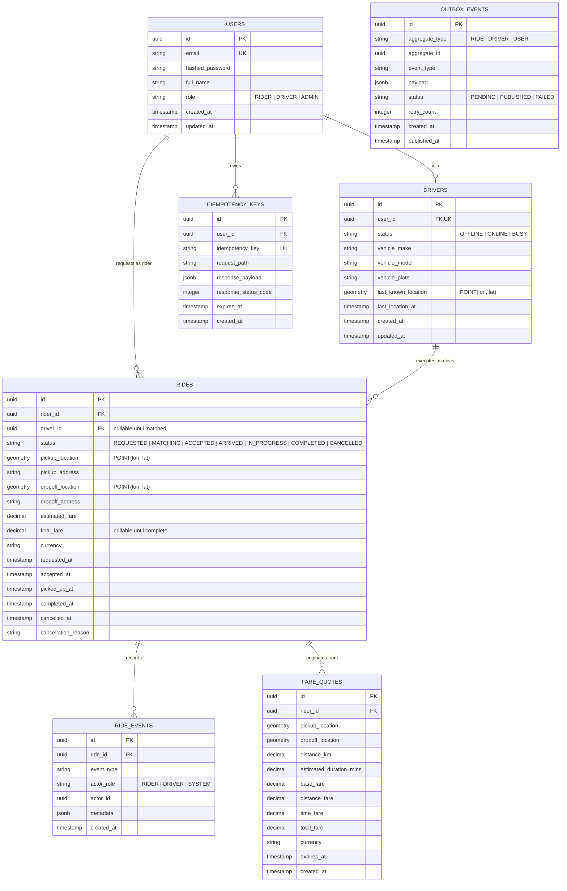

# RideWave — Entity-Relationship (ER) Data Model

## 1. Relational Entities (PostgreSQL)



---

## 2. Invariants & Database Constraints

1. **Active Ride Uniqueness per Driver:**
   ```sql
   CREATE UNIQUE INDEX idx_driver_single_active_ride ON rides (driver_id)
   WHERE status IN ('ACCEPTED', 'ARRIVED', 'IN_PROGRESS');
   ```
2. **Spatial Indexes:**
   ```sql
   CREATE INDEX idx_rides_pickup_location ON rides USING GIST (pickup_location);
   CREATE INDEX idx_rides_dropoff_location ON rides USING GIST (dropoff_location);
   CREATE INDEX idx_drivers_last_location ON drivers USING GIST (last_known_location);
   ```
3. **Idempotency Protection:**
   ```sql
   CREATE UNIQUE INDEX idx_user_idempotency_key ON idempotency_keys (user_id, idempotency_key);
   ```
4. **Time & Audit Consistency:**
   All timestamps stored in UTC (`TIMESTAMPTZ`).
