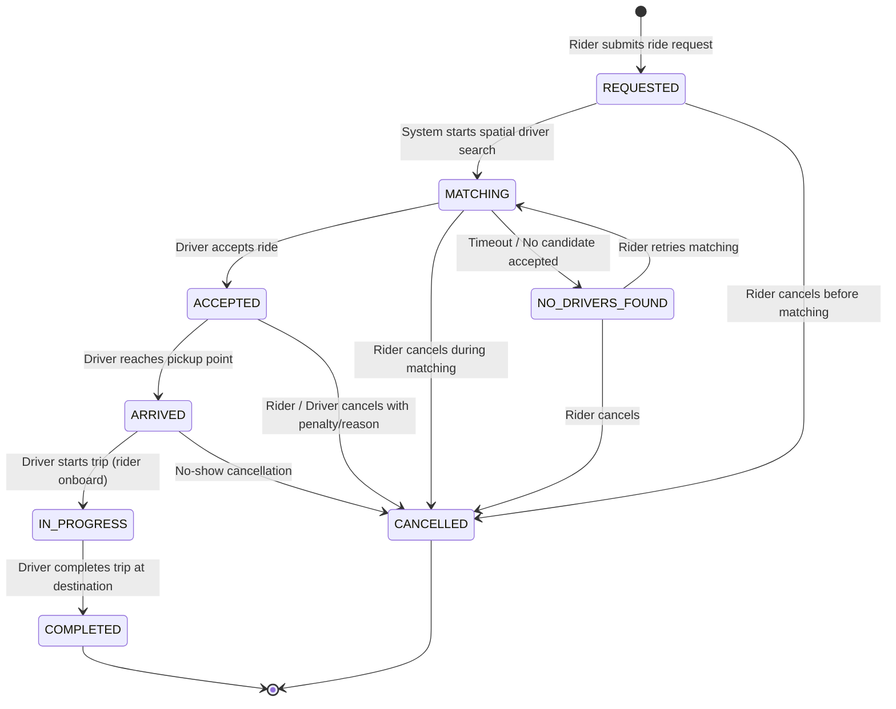

# RideWave — Ride Lifecycle State Machine

## 1. State Diagram

---

## 2. Transition Rules and Invariants

| From State | To State | Trigger | Authorized Actor | Invariant Checks |
|---|---|---|---|---|
| `none` | `REQUESTED` | `POST /rides` | Rider | Quote valid; Rider has no active ongoing ride |
| `REQUESTED` | `MATCHING` | Spatial Search | System | Find nearby online drivers within radius |
| `MATCHING` | `ACCEPTED` | `POST /rides/{id}/accept` | Driver | Driver is `ONLINE`; Driver has 0 active rides (enforced via partial index) |
| `ACCEPTED` | `ARRIVED` | `POST /rides/{id}/arrive` | Assigned Driver | Proximity check (driver is near pickup location) |
| `ARRIVED` | `IN_PROGRESS` | `POST /rides/{id}/start` | Assigned Driver | Rider is picked up; PIN or confirmation if required |
| `IN_PROGRESS` | `COMPLETED` | `POST /rides/{id}/complete` | Assigned Driver | Destination reached; final fare calculated |
| `REQUESTED` / `MATCHING` | `CANCELLED` | `POST /rides/{id}/cancel` | Rider | Cancellation allowed free of charge |
| `ACCEPTED` / `ARRIVED` | `CANCELLED` | `POST /rides/{id}/cancel` | Rider / Driver | Cancellation recorded with reason and audit timestamp |

---

## 3. Disallowed Transitions

- `COMPLETED` $\to$ Any state (Terminal state; cannot be reopened)
- `CANCELLED` $\to$ Any state (Terminal state)
- `IN_PROGRESS` $\to$ `CANCELLED` (Active trip must be formally ended/resolved, not cancelled casually)
- Status modifications by unauthorized actors (e.g. non-assigned drivers, other riders) are rejected with `403 Forbidden`.
